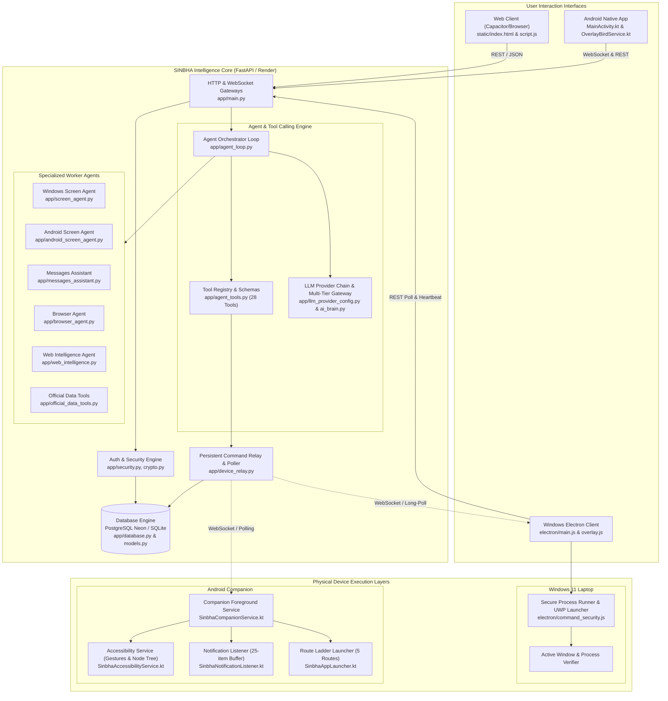

# SINBHA — Existing Architecture Audit
**Audit Date:** November 5, 2026  
**Audited Codebase Version:** `v1.4.28` (Android `versionCode: 55`)  
**Status:** PHASE 0 Audit Specification  

---

## 1. Executive Architecture Summary

SINBHA is engineered as a hybrid AI Operating System spanning three major computing tiers:
1. **Central Intelligence Cloud (Backend):** FastAPI + SQLAlchemy 2.0 ORM (PostgreSQL on Neon with SSL & SQLite local fallback) deployed on Render. Hosts the tool-calling agent loop, LLM provider fallback routing, encrypted device command relays, user identity, and session/audit records.
2. **Windows Desktop Agent:** Electron desktop app (`electron/main.js` + `electron/command_security.js`) featuring a transparent click-through bird overlay, local system tray, safe process launcher (`spawn`/`execFile` with argument arrays), UWP/Store app indexing (`Get-StartApps`), and long-polling command consumer.
3. **Android Native Companion:** Android application built with Capacitor + native Kotlin (`SinbhaCompanionService`, `SinbhaAccessibilityService`, `SinbhaNotificationListener`, `SinbhaAppLauncher`). Features persistent foreground dataSync service, floating overlay bird, high-priority full-screen intent alarm activity, accessibility node tree inspection, gesture execution, and notification listener buffer.

---

## 2. Master Architecture Diagram



---

## 3. Subsystem Breakdown & Exact File Locations

### 3.1 Backend & Intelligence Core (`app/`)

| Module Path | Description & Architectural Purpose |
|---|---|
| `app/main.py` | FastAPI application entrypoint. Declares 60+ endpoints: `/api/chat`, auth routes, device pairing, telemetry, diagnostic test runners (`/api/devices/real-device-check`, `/api/devices/background-launch-test`), and WebSocket handler `/ws/device/{device_id}`. |
| `app/agent_loop.py` | Central multi-step orchestrator (`run_agent_loop`). Manages prompt synthesis, tool calling execution loop (up to `MAX_AGENT_STEPS = 8`), provider fallback recovery, action receipt compilation, and contradictory text suppression. |
| `app/agent_tools.py` | Central `ToolRegistry` maintaining 28 registered tools (`open_app`, `open_settings`, `open_url`, `type_text`, `press_keys`, `search_web`, `fetch_page`, `remember_fact`, `create_task`, `ring_phone`, `send_note`, etc.). Handles permission levels (0–4) and argument schema validation. |
| `app/llm_provider_config.py` | Configuration-driven multi-tier provider chain (`build_ordered_provider_chain`): Primary Groq (`openai/gpt-oss-20b`), Fallback 1 Google AI Studio (`gemini-3-flash-preview` with 1M TPM tier), Fallback 2 OpenRouter (`google/gemini-2.5-flash`), and Dev Local (strictly rejected in production). Dynamic model discovery and token telemetry. |
| `app/ai_brain.py` | Base prompts, system prompt template, model lockout caching, and fallback credentials provider (`get_llm_credentials`). |
| `app/database.py` | SQLAlchemy 2.0 connection engine with `QueuePool` (PostgreSQL Neon with forced SSL) and SQLite fallback. Session managers, Argon2 password hashing, and user query operations. |
| `app/models.py` | Declarative SQLAlchemy models: `User`, `Session`, `Device`, `DeviceCommand`, `Task`, `Fact`, `Message`, `AuditLog`, `PendingAction`, `SearchCache`, `SearchUsageLog`, `DeviceToken`, and `LoginAttempt`. |
| `app/device_relay.py` | Command Relay Manager (`CommandRelayManager`). Manages command lifecycle: `queued` &rarr; `delivered` &rarr; `started` &rarr; `succeeded`/`failed`. Implements replay protection, 30 cmd/min rate limits, and multi-worker database polling. |
| `app/command_schema.py` | Canonical command schemas, packet wrapping/unwrapping, and cross-platform validation. |
| `app/security.py` | Session authentication (`get_current_user`), Argon2 verifier, rate limiting, and security headers. |
| `app/crypto.py` | Fernet-based symmetric encryption for device command payloads, sensitive settings, and passwords at rest. |
| `app/email_service.py` | SMTP transport handler for user verification and password reset tokens. |
| `app/screen_agent.py` | Desktop Screen Agent (Windows). GDI desktop capture, coordinate grounding, safe typing allowlist, and sensitive window keyword blocker. |
| `app/android_screen_agent.py` | Mobile Screen Agent. Converts accessibility node trees into element roles, bounds, and interactive targets. Implements `NEVER_TOUCH_PACKAGES` (UPI, banking, password managers). |
| `app/messages_assistant.py` | Messaging & Notification Assistant. Reads recent notification items, identifies senders, detects prompt injections, and generates draft replies without storing raw recipient messages. |
| `app/browser_agent.py` | Playwright browser automation agent. Controls visible Chrome using isolated profile (`~/.sinbha/browser_profile`). 8 semantic DOM tools, CAPTCHA pausing, and form gating. |
| `app/official_data_tools.py` | Official Google & YouTube Data API integrations (read-only scopes for Gmail and YouTube). |
| `app/search.py` & `app/web_intelligence.py` | Tavily web search wrapper with 24-hour cache and multi-page research synthesizer. |

---

### 3.2 Android Native Companion (`android/app/`)

| File Path | Component & Operational Role |
|---|---|
| `android/app/src/main/AndroidManifest.xml` | Android manifest declaring permissions (`SYSTEM_ALERT_WINDOW`, `BIND_ACCESSIBILITY_SERVICE`, `BIND_NOTIFICATION_LISTENER_SERVICE`, `SCHEDULE_EXACT_ALARM`, `FOREGROUND_SERVICE_DATA_SYNC`), services, receivers, and queryable packages. |
| `.../SinbhaCompanionService.kt` | Long-running Foreground Service (`dataSync`). Connects to server WebSocket (`/ws/device/{device_id}`) with automatic 30s polling fallback. Dispatches commands, acquires wake locks, verifies launches via window state events, and reports execution stages. |
| `.../SinbhaAccessibilityService.kt` | Android Accessibility Service. Captures `TYPE_WINDOW_STATE_CHANGED`, dumps semantic node trees (`dumpScreenTree`), executes coordinate taps (`dispatchGesture`), enters text (`ACTION_SET_TEXT`), scrolls, and performs home/back buttons. |
| `.../SinbhaNotificationListener.kt` | Android `NotificationListenerService`. Captures incoming status bar notifications into a thread-safe 25-item memory buffer (`buffer`). Excludes banking, OTPs, and financial keywords. |
| `.../SinbhaAppLauncher.kt` | 5-route ladder launcher for apps, settings, and URLs: Route 1 (`direct_start`), Route 2 (`overlay_window`), Route 3 (`full_screen_intent`), Route 4 (`accessibility_service`), and Route 5 (`needs_tap`). |
| `.../SinbhaApiClient.kt` | HTTP client wrapper for device registration, heartbeat reporting with OS telemetry (`phone_model`, `android_version`, `sdk_int`), and command status callbacks. |
| `.../AlarmActivity.kt` | Full-screen alarm activity (`showWhenLocked`, `turnScreenOn`) for alarm-grade task reminders. |
| `.../BootReceiver.kt` | Restores alarms and re-initializes companion services after device restart (`BOOT_COMPLETED`). |

---

### 3.3 Windows Desktop Client (`electron/`)

| File Path | Component & Operational Role |
|---|---|
| `electron/main.js` | Main Electron process. Runs hidden or in tray, displays transparent overlay bird (`overlay.html`), sends desktop heartbeats, and polls `/api/devices/commands/pending`. Dispatches commands to `command_security.js`. |
| `electron/command_security.js` | Zero-shell process execution engine. Executes apps via `child_process.spawn`/`execFile` with argument arrays. Resolves Start Menu apps via PowerShell `Get-StartApps`, launches `ms-settings:` URIs, types input via clipboard + paste shortcut, and verifies active window appearance. |
| `electron/preload.js` | Context-isolated bridge exposing safe IPC channels (`sinbhaDesktop`) to the frontend WebView. |
| `electron/overlay.js` & `overlay.html` | Click-through transparent overlay window displaying the animated bird flying over other applications. |

---

### 3.4 Frontend Layer (`static/`)

| File Path | Role |
|---|---|
| `static/index.html` | Single-page application shell: Chat interface, Tasks & Alarms board, Memory facts viewer, Device pairing modal, and Diagnostic console (Real Device Check & Background Launch Test). |
| `static/script.js` | Core client script: Chat message handler, action receipt card renderer (with contradictory text suppression), audio alarm player, device heartbeat monitor, and real-time execution tracer. |

---

## 4. Current Communication Protocol Architecture

### 4.1 Command Life Cycle
Every remote command flows through the following structured states:
```
QUEUED (Server DB)
  ├── Sent via WebSocket (if active)
  └── Polled via HTTP /api/devices/commands/pending
        ↓
DELIVERED (Client acknowledged receipt)
        ↓
STARTED (Client begins process start or gesture)
        ↓
VERIFYING (Client checks window appearance or package state)
        ↓
SUCCEEDED / SENT_NOT_VERIFIED / NEEDS_TAP / FAILED
```

### 4.2 Security Boundaries & Permission Hierarchy
- **Level 0 (Read-Only):** Battery status, device listing, notification inbox preview.
- **Level 1 (Low Risk / Reversible):** App launching, URL opening, volume changes, settings navigation.
- **Level 2 (User Confirmation Required):** Sending notes/messages, form submission, task deletion, fact forgetting.
- **Level 3 (Sensitive):** Financial transactions, file deletions, remote locking.
- **Level 4 (Prohibited):** Typing passwords/OTPs, reading banking windows, bypassing lock screens.

